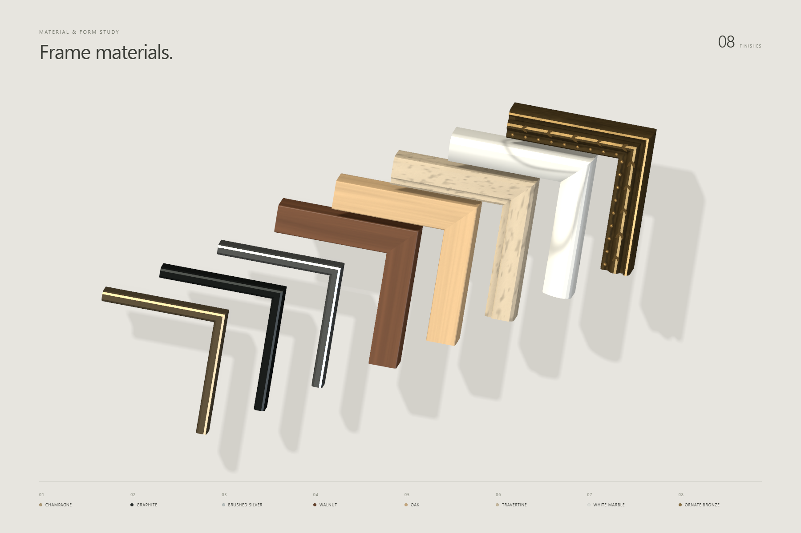

# 3D Poster Frame

React + Three.js 的 3:4 海报展示组件。八款实体型材和 PBR 材质，支持鼠标视差、按住拖动旋转、滚轮缩放、玻璃透射及 PNG 导出。



> 上图由项目中的真实 3D 模型和材质渲染，构图页面与生成脚本一并保留，可重复生成。

## 材质细节

| 材质 | 型材与表面 |
| --- | --- |
| 香槟金 | 窄边金属，细磨表面与柔和倒角 |
| 曜石黑 | 深色石墨涂层，克制反光 |
| 雾银色 | 拉丝铝质感，细窄型材 |
| 胡桃木 | 深色实木宽框，不规则长向纤维 |
| 浅橡木 | 浅色实木宽框，整块木料截面与微倒角 |
| 洞石 | 阶梯型材、浅色石质及自然孔隙 |
| 白大理石 | 圆弧宽框、灰白石纹与抛光表面 |
| 雕纹古铜 | 多层线脚、真实叶形浮雕、珠饰与锤纹 |

纹理按四条边独立连续映射，避免平铺条纹。仅为当前材质生成纹理，切换时释放资源；古铜使用 1024px 贴图，其余为 512px。

## 运行展厅

需要 Node.js 22.12+ 和支持 WebGL2 的浏览器。

```sh
git clone https://github.com/Hfugghg/poster-gallery.git
cd poster-gallery
npm ci
npm run dev
```

打开终端输出的本地地址，通常为 `http://127.0.0.1:5173/`。

- 按住鼠标左键拖动旋转，滚轮缩放；重置按钮同时恢复角度和缩放。
- 底部切换八款边框与海报，也可上传或拖入不超过 20 MB 的 JPG、PNG、WebP。
- 右侧调节图标提供流畅 / 均衡 / 高清预设和独立效果开关，设置保存在当前浏览器。
- 沉浸模式隐藏操作界面，按 `Esc` 退出；导出按钮保存纯 3D 画面的 PNG。

三张默认海报是 Canvas 代码生成的原创几何排版演示，没有下载外部图片。外部图片按 3:4 居中裁切，上传内容仅在浏览器处理。

## 在其他项目使用

从 [Releases](https://github.com/Hfugghg/poster-gallery/releases) 下载轻量 `.tgz` 安装包，或下载源码 ZIP。发布包不附带海报 PNG，也不捆绑 Three.js 等外部依赖。

```sh
npm install ./atelier-poster-frame-1.0.0.tgz
```

目标项目需要 React 19、React DOM 19；`three` 的兼容版本为 `0.181.x`。其他渲染依赖由组件包声明管理。

```tsx
import { PosterFrame } from '@atelier/poster-frame';

export default function Preview() {
  return (
    <PosterFrame
      posterSrc="/posters/my-poster.jpg"
      defaultFrame="bronze"
      defaultQuality="balanced"
      showControls
      style={{ width: '100%', height: 600 }}
    />
  );
}
```

组件没有全局 CSS，也不会自动写入本地存储。支持受控参数、错误回调和 `ref` 方法 `resetView()`、`getCanvas()`、`exportPng()`。完整 API 与受控示例见 [组件接入文档](package-kit/README.md)。

## 画质与性能

默认“均衡”使用 1× 分辨率、轻量 FXAA、半分辨率环境遮蔽和动态阴影，不叠加多种抗锯齿。“流畅”关闭玻璃透射、阴影、环境遮蔽和辉光；“高清”使用更高分辨率和 SMAA。

渲染采用实时 WebGL PBR、环境光照、柔和接触阴影和可选后处理，通过光栅化模拟漫反射与间接光，不是真正的硬件光线追踪。图片导出依赖同源或允许 CORS 的图片地址。

## 构建与发布

```sh
npm run check
npm run build
npm run package:build
npm run package:check
npm run package:release
```

普通提交和 Pull Request 会通过 Actions 检查类型、构建展厅及组件。发布时让 `package-kit/package.json` 的版本与标签保持一致：

```sh
git tag v1.0.0
git push origin v1.0.0
```

发布工作流将轻量 `.tgz` 和源码 ZIP 上传到 GitHub Releases，通过内置 `GITHUB_TOKEN` 授权，无需额外发布密钥。此流程不向 npmjs.com 发布。

## 主要文件

- `src/PosterFrame.tsx`、`src/library.ts`：可复用组件与公共 API。
- `src/Scene.tsx`：相机、灯光、玻璃、旋转缩放和后处理。
- `src/FrameModel.tsx`、`src/frameTextures.ts`：实际框体几何、材质与纹理。
- `src/MaterialStudy.tsx`：README 材质图的独立构图。
- `src/App.tsx`：完整展厅界面。
- `scripts/`：构建、打包、截图与接入验证。
- `.github/workflows/`：持续集成与自动发布。
